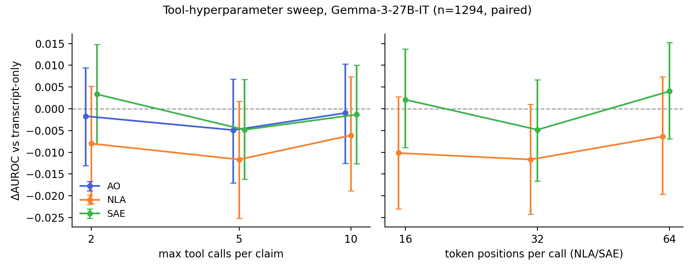

# Tool-hyperparameter sweep — results

Auto-generated by `analyze.py`; do not edit numbers by hand. See README.md for design and `run_all.sh` for end-to-end reproduction.

**Setup.** Gemma-3-27B-IT cf7 eval set; answerer `claude-opus-4-8` effort `high` (identical to the main run). Population: quality slice ∩ all arms, **n=1294** (682 T / 612 F), fully paired. 95% bootstrap CIs (2000 resamples); ΔAUROC CIs are paired against `plain` on the same claims. The 5-call / 32-position rows are the canonical main-run arms read back; the other rows are freshly scored sweep arms. 'calls' counts budget-consuming tool reads (`show_tokens` is free); positions = token positions returned per NLA/SAE call.

**Baseline.** `plain` (transcript-only): AUROC 0.814 [0.792, 0.838].

**Caveat (interface version).** The canonical main-run arms (June) used the tools' earlier segment-based selection input (`start_segment`/`end_segment`); the fresh sweep arms use the current selection-string interface (segment runs, token ranges, scattered tokens). So the *(main run)* rows differ from the sweep rows in interface version as well as knob value. Empirically this is also a wash — every fresh arm sits within ~±0.01 AUROC of its canonical center point — and sweep-vs-sweep comparisons (2 vs 10 calls; 16 vs 64 positions) are interface-identical.

## Tool calls per claim (positions fixed at 32)

| arm | AUROC [95% CI] | ΔAUROC vs plain [95% CI] | acc@0.5 | Brier | forced submits | med (mean) calls used |
|---|---|---|---|---|---|---|
| AO — 2 calls | 0.813 [0.790, 0.836] | -0.002 [-0.013, +0.009] | 73.3% | 0.180 | 95.4% | 2 (1.9) |
| AO — 5 calls *(main run)* | 0.809 [0.786, 0.832] | -0.005 [-0.017, +0.007] | 72.7% | 0.180 | 0.8% | 2 (2.4) |
| AO — 10 calls | 0.813 [0.790, 0.836] | -0.001 [-0.013, +0.010] | 74.3% | 0.178 | 0.0% | 2 (2.8) |
| NLA — 2 calls | 0.806 [0.784, 0.829] | -0.008 [-0.022, +0.005] | 71.8% | 0.185 | 86.3% | 2 (1.9) |
| NLA — 5 calls *(main run)* | 0.803 [0.779, 0.825] | -0.012 [-0.025, +0.002] | 71.3% | 0.186 | 0.0% | 2 (2.1) |
| NLA — 10 calls | 0.808 [0.785, 0.831] | -0.006 [-0.019, +0.007] | 72.4% | 0.184 | 0.0% | 2 (2.4) |
| SAE — 2 calls | 0.818 [0.794, 0.841] | +0.003 [-0.008, +0.015] | 73.8% | 0.177 | 89.0% | 2 (1.9) |
| SAE — 5 calls *(main run)* | 0.810 [0.786, 0.833] | -0.005 [-0.016, +0.007] | 71.9% | 0.180 | 0.0% | 2 (1.8) |
| SAE — 10 calls | 0.813 [0.791, 0.835] | -0.001 [-0.013, +0.010] | 73.5% | 0.179 | 0.0% | 2 (2.2) |

## Token positions per call (calls fixed at 5; NLA/SAE only — the AO selects transcript segments, not token positions)

| arm | AUROC [95% CI] | ΔAUROC vs plain [95% CI] | acc@0.5 | Brier | forced submits | med (mean) calls used |
|---|---|---|---|---|---|---|
| NLA — 16 positions | 0.804 [0.780, 0.826] | -0.010 [-0.023, +0.003] | 71.0% | 0.185 | 0.5% | 2 (2.3) |
| NLA — 32 positions *(main run)* | 0.803 [0.779, 0.825] | -0.012 [-0.024, +0.001] | 71.3% | 0.186 | 0.0% | 2 (2.1) |
| NLA — 64 positions | 0.808 [0.784, 0.829] | -0.006 [-0.020, +0.007] | 72.1% | 0.185 | 0.5% | 2 (2.2) |
| SAE — 16 positions | 0.816 [0.793, 0.839] | +0.002 [-0.009, +0.014] | 73.3% | 0.178 | 0.5% | 2 (2.2) |
| SAE — 32 positions *(main run)* | 0.810 [0.785, 0.833] | -0.005 [-0.017, +0.007] | 71.9% | 0.180 | 0.0% | 2 (1.8) |
| SAE — 64 positions | 0.818 [0.795, 0.841] | +0.004 [-0.007, +0.015] | 74.0% | 0.177 | 0.1% | 2 (2.1) |

## Additionally tried (not re-run on the current bank)

- **Full-dump / no-selection ceiling (NLA).** Every token's NLA verbalization dumped into a single Opus call (no agent loop, no selection step), on the ≤800-token-transcript slice of the OLD pre-cf7 n1000 bank (n=398): full dump AUROC 0.784 vs plain 0.806 vs the 5-call agent arm 0.801 — removing the targeting/selection bottleneck entirely does not help. Write-up: `NLA_FULL_DUMP_RESULTS.md` (raw result JSONLs were not retained; numbers are from that write-up).
- **Earlier ad-hoc 32→64-position NLA run** (old bank, n=500; not included in this release): a wash vs 32 — superseded by the 64-position arm above.
